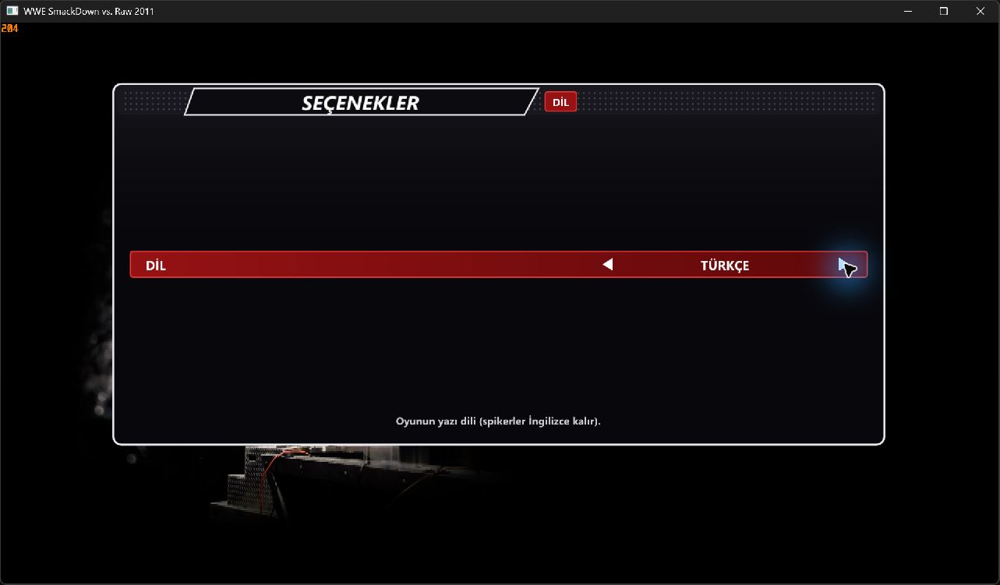

# WWE SmackDown vs. Raw 2011 — PC Türkçe Yama

KaikoClanworth1'in PC portu için Türkçe menüler, hikâye metinleri, başlatıcı arayüzü ve Türkçe karakter desteği. Paket 104, mevcut beş dili koruyarak **TÜRKÇE** seçeneğini ekler. Türkçe kaynaklar `Mods/Languages/tr-TR` içinden yüklenir.

**[Paketi indir](https://github.com/ErdemYaziciOfficial/wwe-svr2011-turkce-yama/releases/latest)** · [Credits](CREDITS.md)

## Gereksinimler ve uyumluluk

- Windows ve kurulu [WWE SvR2011 PC portu](https://github.com/KaikoClanworth1/wwe-svr2011-pc).
- Yama, portun 2.0.6 / `b4884ac95884406b9b51157479de5a228888fc83` tabanı üzerinde hazırlandı. Diğer sürümler için uyumluluk garantisi verilmez; kurucu temel dosya SHA-256 değerlerini kontrol eder.
- Oyunun kendi kopyanızdan kurulmuş olması gerekir. Bu paket tek başına oyun değildir; ISO ve kayıt dosyaları içermez. Çevrilmiş oyun kaynakları ve uyumlu çalıştırıcı/DLL dosyaları içerir.
- Eski yama İngilizce dosyaların üstüne yazıldıysa önce **o yamanın kendi yedeği/geri alma yöntemiyle** orijinal dosyalara dönün. Kayıtlarınızı ayrıca yedeklemeniz önerilir.

## Adım adım kurulum

1. Releases sayfasından `WWE-SvR2011-Turkce-104.zip` dosyasını indirin. GitHub'ın otomatik **Source code** arşivleri kurulum paketi değildir.
2. ZIP'i oyun klasöründen **ayrı** bir klasöre tamamen çıkarın. ZIP'in içinden çalıştırmayın.
3. Oyunu ve **SvR2011 Launcher** başlatıcısını kapatın.
4. `Kur.ps1` dosyasının bulunduğu klasörde PowerShell açın. Aşağıdaki yolu, `svr2011.exe` bulunan gerçek oyun klasörünüzle değiştirerek çalıştırın:

```powershell
.\Kur.ps1 -OyunKlasoru "D:\Oyunlar\SvR2011"
```

5. Kurucu paket bütünlüğünü ve temel dosyaları doğrular; eski çalıştırıcıları/ayarları oyun klasöründeki `TR-Yedek-*` klasörüne yedekler. Türkçeyi seçip kurulumu tamamlar. Bu yedeği saklayın.
6. Oyunu normal başlatıcınızdan açın. Dil değişikliği için **MY WWE > OPTIONS > LANGUAGE** ekranından **TÜRKÇE** seçin ve oyunu kapatıp yeniden açın. Diğer dillere geçişte de yeniden başlatın.

Yönetici yetkisi normalde gerekmez. Eski portun yanına yalnızca `Mods` klasörünü atmak yeterli değildir: paketteki uyumlu çalıştırıcılar kurucu tarafından yüklenmelidir. Sonraki port güncellemeleri bu çalıştırıcıları değiştirebilir; sürüm uyumluluğunu kontrol etmeden üstüne güncelleme yapmayın.

### PowerShell betiği engellenirse

Önce betiği ve kaynağını kontrol edin. İnternetten indirildiği için işaretlenmiş dosyalar için paket klasöründe `Unblock-File .\Kur.ps1` kullanabilirsiniz. Kurum politikasını değiştirmeyin. Kişisel bilgisayarınızda yürütme politikası hâlâ engelliyorsa yalnız bu komutun işlemi için:

```powershell
powershell.exe -NoProfile -ExecutionPolicy Bypass -File .\Kur.ps1 -OyunKlasoru "D:\Oyunlar\SvR2011"
```

### Hatalar

- **Oyun açık / başlatıcı açık:** ikisini de kapatıp tekrar deneyin.
- **Uyumsuz veya eski yamalı temel dosya:** yanlış oyun sürümü veya eski yama vardır. Kurucu bu kontrolde dosya değiştirmez; orijinal uyumlu kurulumu geri getirin. Kontrolü atlamayın.
- **Paket bozuk:** ZIP'i yeniden indirip ayrı klasöre çıkarın. Release'teki `.sha256` dosyası ile `Get-FileHash .\WWE-SvR2011-Turkce-104.zip -Algorithm SHA256` çıktısını karşılaştırabilirsiniz.
- **Erişim engellendi:** oyun klasörünün yazılabilir olduğundan ve dosyaların başka programca kullanılmadığından emin olun.

## Geri alma

Oyun ve başlatıcı kapalıyken paket klasöründen, kurucunun bildirdiği gerçek yedek yoluyla:

```powershell
.\Geri-Al.ps1 -YedekKlasoru "D:\Oyunlar\SvR2011\TR-Yedek-TARIH-KIMLIK"
```

Önceki çalıştırıcılar ve ayarlar geri yüklenir. Yeni Türkçe dil dosyaları diskte kalabilir; eski çalıştırıcı bunları kullanmaz. Kurucu ISO'ya ve oyun kayıtlarına dokunmaz.

## Kapsam ve bilinen sınırlar

- Menü/hikâye çevirileri, PC arayüzü ve Türkçe font desteği paket içindedir.
- John Cena'nın ilk MVP maçından sonraki RTWM sahnesinde bildirilen karakter hatasının düzeldiği kullanıcı tarafından doğrulandı.
- Özel adlar, hareket adları, teknik/ses kimlikleri ve Dummy/Text yer tutucuları çeviri hedefi değildir. Bu kayıtlar çevrilmiş olarak sayılmaz.
- Görsellere gömülü kalan İngilizce yazılar ertelendi. Önceden kurulmuş YENİ/HAZIR texture paketleri korunur ancak bu arşive dahil değildir.
- Bu sürüm için baştan sona yeni bir oyun/RTWM oynanışı testi yapılmadı; **%100 çeviri veya hatasızlık iddiası yoktur**.
- Dil ekranı, İngilizce/Türkçe arasında seçim ve yeniden başlatma, iki dilde 60'ar dosya okuma, kurulum/geri alma ve bozuk paket engeli doğrulandı.



## Kaynak ve katkılar

Bu bağımsız fan yamasının yönetimi ve oyun içi geri bildirimi **ErdemYaziciOfficial**, AI destekli çeviri ve teknik uygulaması **OpenAI Codex** ile yapılmıştır. PC portunun ve altyapıların tüm katkıları [CREDITS.md](CREDITS.md) içindedir. Kaynak değişiklikleri ve üçüncü taraf bildirimleri Release paketinde bulunur. Orijinal oyun, port ve üçüncü taraf bileşenlerinin hakları sahiplerine aittir; tüm pakete tek bir lisans atanmamıştır.
